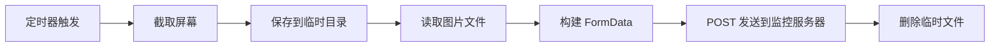

# EC监控工具 - 项目文档

## 📋 项目概述

EC监控工具是一个基于 Electron 开发的在线考试客户端，用于牛客网（nowcoder.com）的编程竞赛和考试场景。该应用提供全屏锁定、进程监控、屏幕截图等功能，确保考试的公平性和安全性。

---

## 🏗️ 技术架构

### 核心技术栈
- **Electron** (^28.0.0) - 跨平台桌面应用框架
- **Node.js** - 后端运行时
- **axios** (^1.6.0) - HTTP 请求库
- **desktop-screenshot** (^0.1.1) - 屏幕截图功能
- **form-data** (^4.0.5) - 表单数据上传

### 项目结构
```
program/
├── main.js              # Electron 主进程（核心逻辑）
├── preload.js           # 预加载脚本（IPC 通信桥接）
├── webview-preload.js   # Webview 预加载脚本
├── index.html           # 渲染进程 UI 界面
├── config.js            # 统一配置文件
├── package.json         # 项目依赖和配置
└── build/               # 打包资源（图标等）
```

---

## 🔧 核心功能模块

### 1. 进程管理
**位置**: `main.js` - `killBlockedProcessesOnWindows()`

**功能**: 自动关闭通讯和远程控制软件
- QQ、微信、钉钉等企业通讯工具
- ToDesk、TeamViewer、AnyDesk 等远程桌面工具
- 使用 Windows `taskkill` 命令强制终止进程

### 2. 窗口控制
**位置**: `main.js` - `createMainWindow()`

**安全特性**:
- ✅ 全屏模式（无法退出）
- ✅ 无边框窗口
- ✅ 始终置顶
- ✅ 禁止移动和调整大小
- ✅ 禁用最小化
- ✅ 拦截 F5/Ctrl+R 刷新快捷键

### 3. URL 白名单机制
**配置**: `config.js` - `EXAM.ALLOW_HOST_KEYWORD`

**实现位置**: 
- `index.html` - `isAllowedUrl()` 函数
- `main.js` - `web-contents-created` 事件监听

**规则**: 只允许访问包含 `nowcoder.com` 的域名，其他网址会被拦截并弹窗警告。

### 4. 多标签页管理
**位置**: `index.html` - `createTab()`, `switchTab()`, `closeTab()`

**功能**:
- 支持多个考试页面标签
- 拦截 `target="_blank"` 新窗口请求
- 通过 IPC 通信在主进程和渲染进程间传递新标签请求
- 每个标签独立显示标题和 URL

### 5. 退出保护机制
**配置**: `config.js` - `EXIT.CONFIRM_TEXT`

**双重退出方式**:
1. **正常退出**: 点击"退出比赛"按钮 → 输入确认口令 "我同意结束这场比赛"
2. **紧急退出**: 快捷键 `Ctrl+Shift+Alt+Q`（仅开发者知晓）

---

## 📸 屏幕截图功能详解

### 工作流程



### 代码实现

**位置**: `main.js` - `startScreenshotCapture()` (第 83-112 行)

#### 步骤 1: 定时触发
```javascript
setInterval(() => {
  // 每 30 秒执行一次（可配置）
}, config.SCREENSHOT.INTERVAL);
```

#### 步骤 2: 截图保存
```javascript
const screenshotPath = path.join(app.getPath('temp'), config.SCREENSHOT.FILENAME);
screenshot(screenshotPath, (err, complete) => {
  // 截图完成后回调
});
```

**📍 图片保存位置**: 
- Windows: `%TEMP%\exam_screenshot.png`
- 完整路径示例: `C:\Users\用户名\AppData\Local\Temp\exam_screenshot.png`
- 每次截图会覆盖上一次的文件

#### 步骤 3: 读取并发送
```javascript
fs.readFile(screenshotPath, (err, data) => {
  const FormData = require('form-data');
  const form = new FormData();
  form.append('image', data, config.SCREENSHOT.FILENAME);
  form.append('clientId', clientId);
  
  axios.post(
    `http://${monitorIP}:${config.MONITOR_SERVER.DEFAULT_PORT}${config.MONITOR_SERVER.ENDPOINTS.SCREENSHOT}`,
    form,
    { headers: form.getHeaders() }
  );
});
```

### 发送协议

**请求方式**: `POST`  
**Content-Type**: `multipart/form-data`  
**目标地址**: `http://{监控服务器IP}:3000/screenshot`

**请求参数**:
| 参数名 | 类型 | 说明 |
|--------|------|------|
| image | Binary | PNG 格式截图文件 |
| clientId | String | 客户端唯一标识（主机名+时间戳） |

### 生命周期管理

- **启动时机**: 用户选择监控服务器并连接成功后
- **停止时机**: 应用退出时（`will-quit` 事件）
- **异常处理**: 截图失败或发送失败仅在控制台记录错误，不影响程序运行

---

## 🌐 监控服务器通信

### 1. 获取监控服务器列表

**API**: `GET http://api-acnowcoder.exitcode.cn/monitors`  
**位置**: `index.html` - `loadMonitors()` (第 112-143 行)

**响应示例**:
```json
[
  {
    "school": "XX大学",
    "location": "教学楼A",
    "ip": "192.168.1.100"
  }
]
```

### 2. 连接到监控服务器

**流程**:
1. 用户在 UI 选择监控服务器
2. 渲染进程通过 `ipcRenderer.send('ec-select-monitor', monitor)` 发送选择
3. 主进程接收后调用 `connectToMonitor(monitor)`
4. 建立连接并启动心跳和截图

**API**: `POST http://{monitorIP}:3000/connect`  
**请求体**: `{ clientId: "hostname-timestamp" }`

### 3. 心跳保持

**频率**: 每 10 秒  
**API**: `POST http://{monitorIP}:3000/heartbeat`  
**目的**: 告知监控服务器客户端仍然在线

---

## 🔒 安全机制

### CSP (内容安全策略)
**位置**: `index.html` 第 5 行

```html
<meta http-equiv="Content-Security-Policy" 
      content="default-src 'self'; 
               script-src 'self' 'unsafe-inline'; 
               style-src 'self' 'unsafe-inline'; 
               img-src 'self' data: https:; 
               font-src 'self' data:; 
               connect-src 'self' https: http://api-acnowcoder.exitcode.cn; 
               frame-src 'self'; 
               object-src 'none'; 
               base-uri 'self'; 
               form-action 'self'; 
               frame-ancestors 'none';">
```

**关键配置**:
- 允许向特定 HTTP API 发送请求
- 禁止内联框架嵌套（防钓鱼）
- 禁止 object 元素（防插件攻击）

### 单实例锁
**位置**: `main.js` 第 255-268 行

防止用户同时打开多个客户端实例：
```javascript
const gotTheLock = app.requestSingleInstanceLock();
if (!gotTheLock) {
  app.exit(0); // 第二个实例直接退出
}
```

### Context Isolation
**位置**: `main.js` 第 136 行

```javascript
contextIsolation: true,  // 隔离渲染进程和 Node.js 环境
nodeIntegration: false   // 禁用 Node.js 集成
```

---

## ⚙️ 配置文件说明

**位置**: `config.js`

所有可配置项集中管理：

```javascript
{
  MONITOR_API: {
    BASE_URL: 'http://api-acnowcoder.exitcode.cn',
    ENDPOINTS: { GET_MONITORS: '/monitors' }
  },
  MONITOR_SERVER: {
    DEFAULT_PORT: 3000,
    ENDPOINTS: {
      CONNECT: '/connect',
      HEARTBEAT: '/heartbeat',
      SCREENSHOT: '/screenshot'
    }
  },
  SCREENSHOT: {
    INTERVAL: 30000,        // 截图间隔（毫秒）
    FILENAME: 'exam_screenshot.png'
  },
  EXIT: {
    CONFIRM_TEXT: '我同意结束这场比赛',
    SAFE_QUIT_ACCELERATOR: 'CommandOrControl+Shift+Alt+Q'
  },
  BLOCKED_PROCESSES: [...],  // 被禁止的进程列表
  EXAM: {
    URL: 'https://ac.nowcoder.com/',
    ALLOW_HOST_KEYWORD: 'nowcoder.com'
  }
}
```

**修改配置只需编辑此文件，无需改动其他代码。**

---

## 🚀 运行与打包

### 开发环境
```bash
npm install      # 安装依赖
npm start        # 启动开发模式
```

### 生产打包
```bash
npm run build:win    # 打包 Windows 版本
npm run build:mac    # 打包 macOS 版本
npm run build        # 同时打包两个平台
```

**输出目录**: `dist/`  
**安装包类型**: NSIS 安装程序（Windows）

### 打包配置
- **应用 ID**: `com.exam.client`
- **架构**: x64 + ia32（双架构支持）
- **权限**: 需要管理员权限（`requireAdministrator`）
- **快捷方式**: 自动创建桌面和开始菜单快捷方式

---

## 📊 数据流向图

```
┌─────────────┐         ┌──────────────┐         ┌─────────────────┐
│  渲染进程    │  IPC    │   主进程      │  HTTP   │  监控服务器      │
│ (index.html) │ ◄─────► │  (main.js)   │ ◄─────► │ (Monitor Server)│
└─────────────┘         └──────────────┘         └─────────────────┘
       │                        │                         │
       │ 1.选择监控服务器        │                         │
       ├──────────────────────►│                         │
       │                        │ 2.POST /connect         │
       │                        ├──────────────────────►│
       │                        │                         │
       │                        │ 3.启动定时器            │
       │                        │    (每30秒)             │
       │                        │                         │
       │                        │ 4.截图保存到 Temp       │
       │                        │                         │
       │                        │ 5.POST /screenshot      │
       │                        ├──────────────────────►│
       │                        │    (FormData)           │
       │                        │                         │
       │                        │ 6.每10秒心跳            │
       │                        ├──────────────────────►│
       │                        │    POST /heartbeat      │
```

---

## 🛠️ 常见问题

### Q1: 截图保存在哪里？
**A**: 系统临时目录，Windows 下为 `%TEMP%\exam_screenshot.png`。每次截图会覆盖旧文件，不会累积占用磁盘空间。

### Q2: 如何修改截图频率？
**A**: 编辑 `config.js` 中的 `SCREENSHOT.INTERVAL`，单位为毫秒（默认 30000 = 30秒）。

### Q3: 为什么加载监控服务器失败？
**A**: 检查以下几点：
1. 网络连接是否正常
2. API 地址 `http://api-acnowcoder.exitcode.cn/monitors` 是否可访问
3. CSP 配置是否允许该域名（已在 `index.html` 中配置）

### Q4: 如何添加新的白名单域名？
**A**: 修改 `config.js` 中的 `EXAM.ALLOW_HOST_KEYWORD`，改为对应的域名关键词。

### Q5: 紧急退出的快捷键是什么？
**A**: `Ctrl+Shift+Alt+Q`（仅开发人员知晓，普通用户需输入确认口令）。

---

## 📝 开发注意事项

1. **不要移除单实例锁** - 防止多开导致监控失效
2. **不要暴露紧急退出快捷键** - 这是最后的安全保障
3. **CSP 配置谨慎修改** - 错误的配置可能导致功能异常
4. **截图功能依赖网络** - 网络断开时会自动重试，不影响主流程
5. **Webview 预加载路径** - 确保 `webview-preload.js` 存在且路径正确

---

## 📄 许可证

MIT License

---

## 👥 维护者

your-name

---

**最后更新**: 2026-04-24
